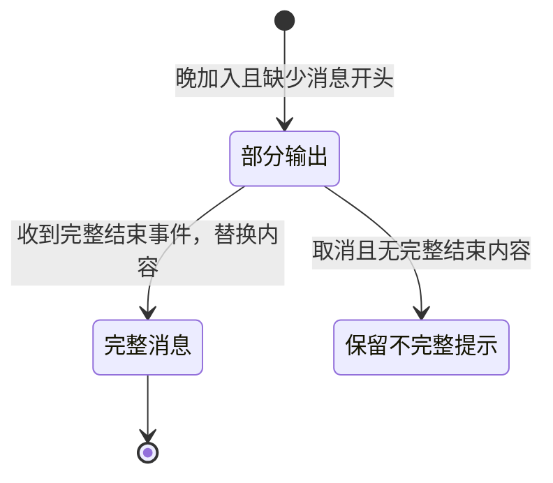

# 流式消息恢复修订建议（待确认）

原有同任务接管、审批和任务脱离 CLI 窗口运行已实测通过。W4 的真实流式竞态测试发现，Codex 0.167.0 在**客户端加入时，当前仍在生成的那一条回复**不包含此前已输出的文字。

分页完整快照和旧式完整历史接口均有此行为。完整历史试验中，原始回复有 13,199 个字符；晚加入客户端只从后续增量拼出了 13,101 个字符，前 98 个字符没有出现在恢复快照中。同一消息 ID 已核对。不能把这个结果写成无遗漏同步通过。

## 建议采用的行为

桥接首次加入或重连上游时，若收到了一条已开始消息的后续片段，而没有取得它的完整前文：

1. 展示当前能收到的内容，并明确标记“部分输出，消息结束后补齐”。
2. 收到该消息的完整结束事件后，以完整内容替换片段，再去掉标记，避免重复拼接。
3. 如果任务取消且上游始终未提供完整消息，保留“部分输出”标记，不声称内容完整。

补充实测已确认：晚加入客户端能收到完整 `item/completed`，其内容与最早连接看到的 13,199 个字符完全一致。因此“结束事件到达后替换补齐”已有真实协议证据；尚未将它当作已批准的产品行为实施。

已经被桥接完整记录的消息按原计划恢复。判断完整性使用消息生命周期和源事件标识，不能通过比较文本猜测、删掉相同片段；连续两个 `ha` 仍然必须保留为 `haha`。

协议可沿用现有 `Item.data`，增加 `prefixComplete: boolean`，手机在该值为 false 时显示提示。完整 `item/completed` 到达后设为 true。单纯的上游恢复快照不能把一个未验证的流式片段标为完整。

这一修订需要确认，因为[原 W4 关卡](../plans/2026-11-08-windows-bridge.md#w4-一致快照增量事件及-sqlite-恢复)要求无法建立无遗漏快照边界时停止，而不能猜测拼接。目前没有实施 W4 存储和后续产品控制功能。

若必须在任意重连时立即恢复正在生成消息的全部前文，需要改造并维护 Codex 服务端，使其快照携带流式前文和可靠的事件边界；当前官方 0.167.0 客户端接口不能保证这一点。

依据为真实受控探针，以及版本对应的官方源代码：[线程监听与恢复](https://github.com/openai/codex/blob/rust-v0.167.0/codex-rs/app-server/src/request_processors/thread_lifecycle.rs)、[历史投影](https://github.com/openai/codex/blob/rust-v0.167.0/codex-rs/app-server-protocol/src/protocol/thread_history.rs)。源代码说明恢复操作的序列化边界，并未提供未完成消息此前的增量文本。
